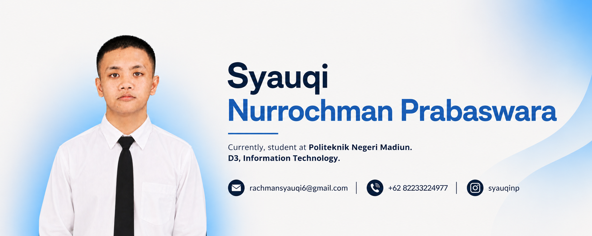

# Profile

  

  

# Hey 👋 What's up?

My name is **Syauqi Nurrochman Prabaswara** and I'm an Information Technology student at **Politeknik Negeri Madiun** passionate about software development, database management, and system design. I enjoy breaking down complex problems into logical steps and translating them into efficient code.

# About me
✨ Creating solutions through code since 2026

📚 I'm currently learning Web Development, JavaScript, Backend Development, and Cybersecurity fundamentals.

🛠️ I frequently design system architectures and flowcharts using **draw.io** and **Flowgorithm** before writing code.

🎓 Recently completed Web Programming certification from Dicoding Coding Camp 3.0.

🎯 Goals: Become a Full Stack Developer and contribute to impactful open-source projects.

📱 Fun fact: I was a developer in a smartphone community, building and maintaining projects for Android users.

### 📊 GitHub Stats

  
  

###

<h2 data-importer="text" align="left">I code with</h2>

###

  
  
  
  
  
  
  
  
  
  
  
  
  
  
  

###

# 🚀 Featured Projects
- **[STARHOP](https://github.com/ItsMeSyauqi/STARHOP)**
   A web-based game project.
   🌐 **Live Demo:** [starhop-games.netlify.app](https://starhop-games.netlify.app/)
  
- **[Dompetku](https://github.com/ItsMeSyauqi/Dompetku)**
   A financial tracking and expense management web application.
   🌐 **Live Demo:** [dompet-ku-pied.vercel.app](https://dompet-ku-pied.vercel.app/)

###

# 🏆 Certifications & Badges
- 🛡️ **[Cybersecurity Defense Analyst Career Path](https://www.credly.com/badges/b8c6bfcc-13b9-4953-b677-4270d8b4b07f/public_url)**
- 🛡️ **[Introduction to IoT](https://www.credly.com/badges/b2dcba88-6edf-45cb-a63d-a6a148f6c9a4/public_url)**

###

# Social Media & Profiles

